# E-commerce Analytics Pipeline · Olist · DuckDB + dbt

[](https://github.com/edwinzhang98/ecommerce-analytics-pipeline/actions/workflows/ci.yml)

**An analytics engineering work sample.** Raw e-commerce data (9 Olist CSVs, 99,441 orders) becomes a tested,
documented **dbt star schema in DuckDB**, so every analyst gets the same order count. The same marts then answer
three business questions in a Streamlit app, an HTML report and plain SQL.

## The business problem

> *"Three analysts got three different order counts, and the business no longer trusts our numbers. Build trusted,
> tested, documented marts so analysts query only marts, never raw."* (Analytics Lead)

On the raw tables, "how many orders?" returns **117,601**, **99,441** or **96,478** depending on how you ask:

- Joining orders to items and payments multiplies rows (*fan-out*). The same join inflates revenue to R$20.31M
  against R$16.01M actually paid.
- Each analyst also used a different definition of "an order".

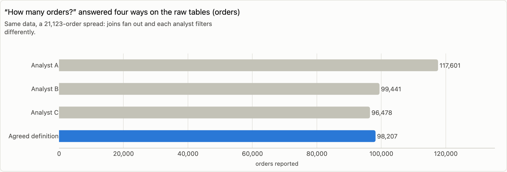

## Results

1. **One order number, enforced by tests.**
   - **98,207 net orders** (placed minus canceled and unavailable) is the official KPI. **Placed (99,441)** and
     **delivered (96,478)** are published under their own names.
   - Six query paths must return the same count; one of them is computed straight from staging and the status
     seed, skipping every intermediate and mart model. A dbt test fails the build if they ever disagree. (The app's
     Overview shows the five analyst-style paths; the test adds the sixth.)
2. **Trust is tested, not claimed.**
   - Profiling found **21 raw-data issues in 9 classes**: per-order customer ids, shared review ids, payments ≠
     items + freight, contradictory timestamps, partial months and more. Each one is handled in the models and
     documented.
   - **300 tests** run on every build (296 data tests + 4 unit tests). **24** of them are *known-issue baselines*:
     they pass at today's count, warn if it grows and fail if it explodes.
   - CI plants every issue that has a known-issue test in a synthetic dataset, and checks that each test catches it.
     DQ-05 and DQ-21 have no test and are documented only.
3. **The marts support real analysis.** These are associations in 2016-2018 data, not causal effects.
   - **Delivery and reviews.** Late deliveries get a 1-2 star review **62.4%** of the time vs **9.3%** on time.
     Across states, late rate and bad-review rate correlate at r = 0.94; AL, MA and SE are late most often. RJ is
     the one state whose bad reviews clearly exceed what its lateness and delivery times predict (PA's and BA's
     excess is explained by slower deliveries), and it has the second-most late deliveries.
   - **Repeat purchase.** Only **2.17%** of customers ever buy again on a different day. Counting orders instead
     of purchase days would say 3.04%, because some checkouts split into several orders.
   - **Sellers.** The top 10% of sellers hold **66.7%** of net GMV. When a seller misses its own handover
     deadline, **20.9%** of orders arrive late vs **5.4%**.

| Late deliveries and bad reviews | When the seller hands over late |
|---|---|
| 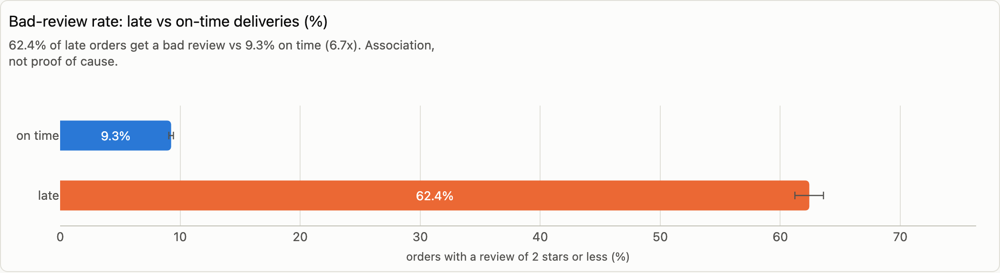 | 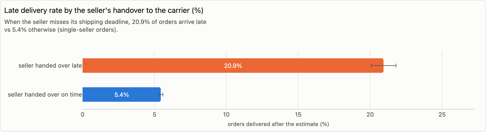 |

## Recommendations

| Who | What | Expected impact | How we measure | Risk |
|---|---|---|---|---|
| Analytics Lead + Finance | Adopt **net orders** as the headline order KPI; keep placed and delivered under their own names | One order number in every report | Conflicting order counts in business reviews: zero; the 6-path dbt test stays green | Finance may prefer delivered orders: a change to the status seed plus a full refresh (ADR 0002) |
| Analysts | Query `marts` only; retire raw-table dashboards | No fan-out or definition errors | Share of reports reading marts | Migration effort |
| Logistics | Review carriers and routes in RJ first; in AL, MA and SE make the delivery estimate route-specific | Fewer late deliveries; at most ~53 fewer bad reviews per 100 late deliveries avoided (upper bound) | Monthly late and bad-review rate, RJ vs MG and SP; AL/MA/SE before vs after | RJ does worse even on time; a later promised date can cost sales |
| Seller management | Work the 34 sellers above both the late-handover and bad-review thresholds, the 15 that clearly exceed both first | Lower late-handover rates | Their rates vs flagged sellers not yet contacted | Some flags are chance; 72% of late deliveries follow an on-time handover |
| CRM | Pilot a second-purchase offer 30-90 days after the first delivery, with a random no-offer group | A measured lift on a ~2% base | 180-day repeat rate, pilot vs no-offer group | A 2% base needs a large pilot |

The one-page business memo is [docs/readout.md](docs/readout.md). The full write-up, with every chart, is
[reports/report.html](reports/report.html): download and open it, no server needed.

## Architecture

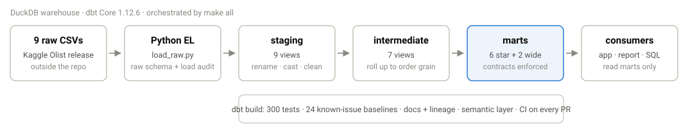

- **raw.** Python EL loads the 9 files unchanged (all VARCHAR) into DuckDB and writes a load audit.
- **staging** (9 views). One model per source table: rename, cast, clean, de-duplicate.
- **intermediate** (7 views). Roll items, payments and reviews up to one row per order *before* joining, so
  nothing can fan out. Order status and lifecycle logic; person-level customers.
- **marts** (8 tables, contracts enforced). The star schema `fct_orders`, `fct_order_items` (incremental),
  `dim_customers` (with RFM fields), `dim_products`, `dim_sellers`, `dim_date`, plus two wide tables,
  `customer_360` and `seller_scorecard`.
- **Also in the project:**
  - 4 seeds, the order-status definition among them (plus the evaluator-exceptions seed used by `make lint`);
  - an SCD2 snapshot of order status;
  - a MetricFlow semantic layer with 11 metrics;
  - exposures for the app and the analyses.

Lineage as dbt docs draws it (sources on the left, the app and analyses on the right):

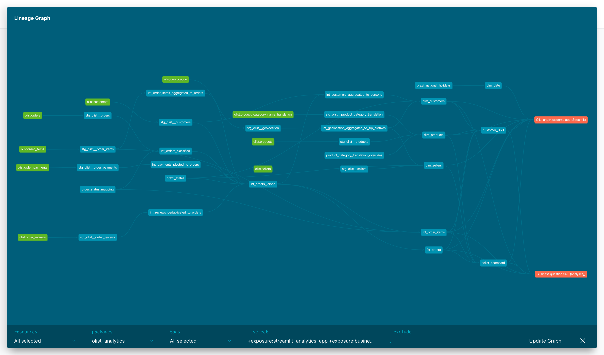

## Run it

You need [uv](https://docs.astral.sh/uv/) and the 9 Olist CSV files from Kaggle
([olistbr/brazilian-ecommerce](https://www.kaggle.com/datasets/olistbr/brazilian-ecommerce)).

```bash
git clone https://github.com/edwinzhang98/ecommerce-analytics-pipeline.git && cd ecommerce-analytics-pipeline
```

```bash
make all
```

```bash
uv run streamlit run dashboard/app.py
```

`make all` installs the environment, loads the CSVs, runs `dbt build` (models and all tests), generates dbt docs,
exports the app cache, executes the notebooks and builds the HTML report.

- **Where the CSVs live.** The data path is set in [`config.yaml`](config.yaml) (`raw_data_dir`, default
  `~/projects/data-projects/datasets/p7-olist`). Override it without editing files:
  `OLIST_RAW_DIR=/path/to/csvs make all`, or copy `.env.example` to `.env`.
- **Nothing is committed.** No raw data is in the repository.
- **Other targets** (`make help` lists them all):
  - `make incremental-check` proves the incremental model;
  - `make lint` runs the strict parse and the dbt_project_evaluator;
  - `make metrics` queries the semantic layer;
  - `make ci-local` runs CI on the synthetic fixture.

## Data quality summary

| Class | Issues | Example | Handling |
|---|---:|---|---|
| Keys, identity & grain | 5 | `customer_id` is issued per order: 96,096 people behind 99,441 ids | Customer marts keyed on `customer_unique_id`; per-order id not exposed |
| Duplicates | 1 | 261,831 exact duplicate geolocation rows | De-duplicated; one median point per zip prefix |
| Missing values & records | 3 | 775 orders without items; 610 products without category | Left-join after aggregation, flags, `unknown` category |
| Invalid / out-of-range values | 4 | 31 geolocation points outside Brazil | Excluded or kept and monitored |
| Contradictory timestamps | 2 | 1,359 orders picked up by the carrier before payment approval | Flagged in `fct_orders`, never dropped |
| Cross-table reconciliation | 1 | 249 orders where payments ≠ items + freight by > R$1 (mostly card installments, most likely interest) | GMV = items + freight; payments kept separately |
| Text, encoding & format | 2 | Seller cities like "sao paulo - sp", a UTF-8 BOM, line breaks inside CSV fields | Cleaning macro, load audit of lines vs rows |
| Coverage & reference data | 2 | Only 2017-01 to 2018-08 is complete; 2 untranslated categories | `is_complete_data_month`; translation seed |
| Undocumented semantics | 1 | No time zone; "review_creation_date" is the survey-sent date | Documented assumption, renamed columns |

Details are in [docs/data_quality_report.md](docs/data_quality_report.md) and
[docs/03_data_quality_checks.md](docs/03_data_quality_checks.md).

## Modelling decisions

Recorded as ADRs in [docs/adr/](docs/adr/):

- [0001](docs/adr/0001-layered-architecture.md) **Layered architecture.** raw → staging → intermediate → marts;
  dbt Core 1.12 on DuckDB, kept dbt-v2-ready.
- [0002](docs/adr/0002-order-status-and-net-orders.md) **What counts as an order.** Net orders as the KPI; placed
  and delivered named separately; defined in one seed.
- [0003](docs/adr/0003-grain-fan-out-and-customer-identity.md) **Grain, fan-out and customer identity.**
  Aggregate before joining; grain and reconciliation tests; people = `customer_unique_id`.
- [0004](docs/adr/0004-payments-cancellations-and-refunds.md) **Payments, cancellations and refunds.** GMV as the
  revenue measure, likely card interest, no refund data.
- [0005](docs/adr/0005-incremental-fct-order-items.md) **Incremental `fct_order_items`.** Watermark plus lookback
  plus re-processing of open orders, proven equal to a full refresh.

## Tests and CI

- **Hard rules** (error on any failure): keys, not-null, accepted values, fact-to-dimension relationships, amounts
  ≥ 0, event order (nothing delivered before it was bought), grain guards, reconciliation of item, order, customer
  and seller GMV, and the load audit. They use 6 custom generic test types and 3 singular tests (the six-path
  order count, category translations, complete-month volume). 4 unit tests cover the trickiest transformations.
- **Known-issue baselines.** 24 tests (20 generic, 4 singular) whose failing rows are stored in a `test_failures`
  schema for inspection.
- **CI** ([ci.yml](.github/workflows/ci.yml)) runs on every pull request and push:
  - strict parse (deprecations are errors);
  - synthetic fixture, then load, then `dbt build`;
  - a check that every known-issue test detects its planted issue;
  - source freshness;
  - `dbt_project_evaluator` (any violation fails);
  - a MetricFlow smoke test;
  - the incremental-vs-full-refresh check;
  - dbt docs.
- **Incremental proof** ([scripts/check_incremental.py](scripts/check_incremental.py)), on an extract as of
  2018-07-01 followed by the full data:
  - 1,939 existing rows changed status and were updated, 1,344 of them older than the lookback window;
  - incremental equals full refresh, row for row;
  - late-arriving rows beyond the window are caught by the grain test.

## The demo app

`uv run streamlit run dashboard/app.py`. Seven pages in presentation order. Each page states its question at the
top and ends with a plain-language *How to read this* box. Business questions and Dashboard recompute live from the
marts when you move the controls.

| | |
|---|---|
| **Overview**: the problem, the architecture, the fix 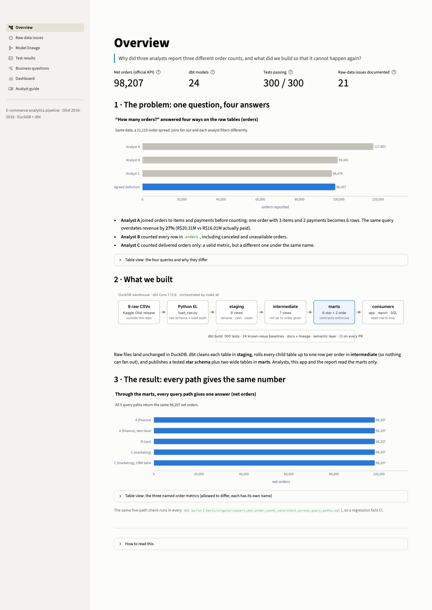 | **Raw data issues**: the register, plus a live payment-tolerance check 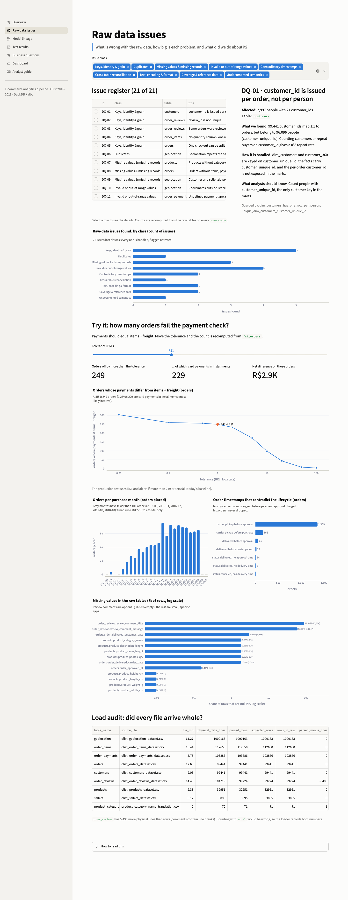 |
| **Model lineage**: dbt docs graph plus a dependency explorer 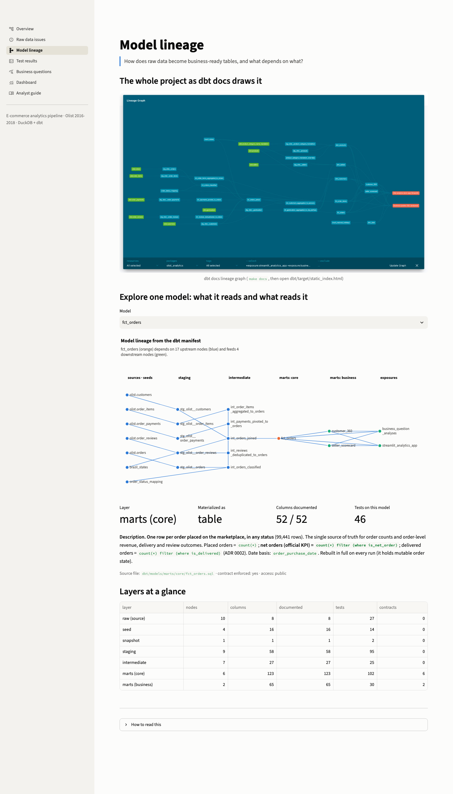 | **Test results**: 300 tests, baselines, incremental proof 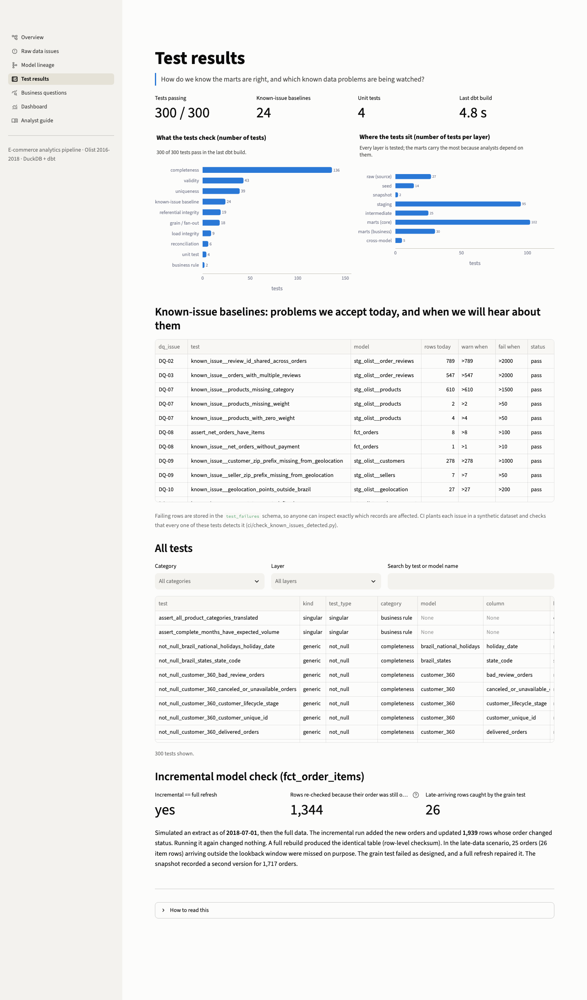 |
| **Business questions**: Q1-Q3 with live parameters 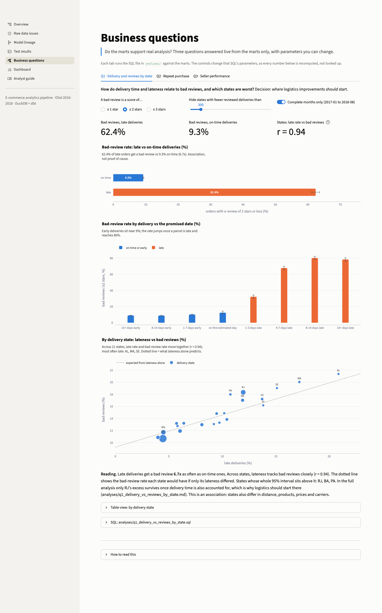 | **Dashboard**: orders, revenue, delivery, filters 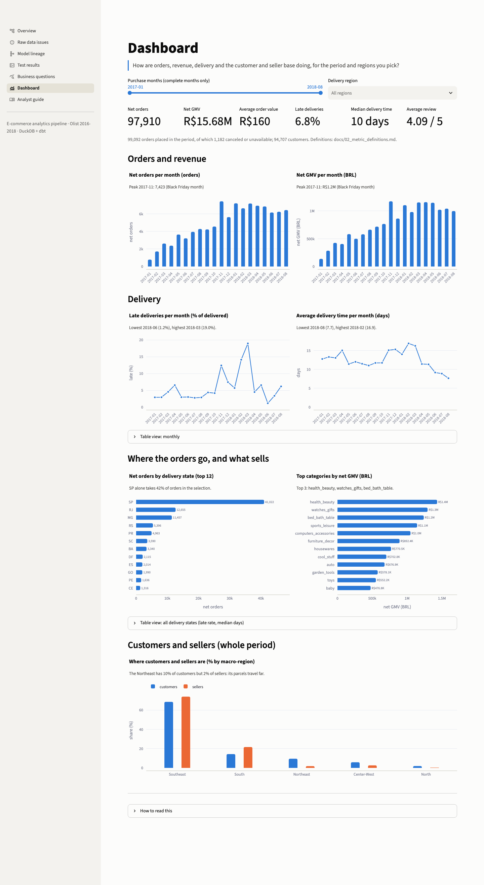 |
| **Analyst guide**: which table, how to join, a SQL playground 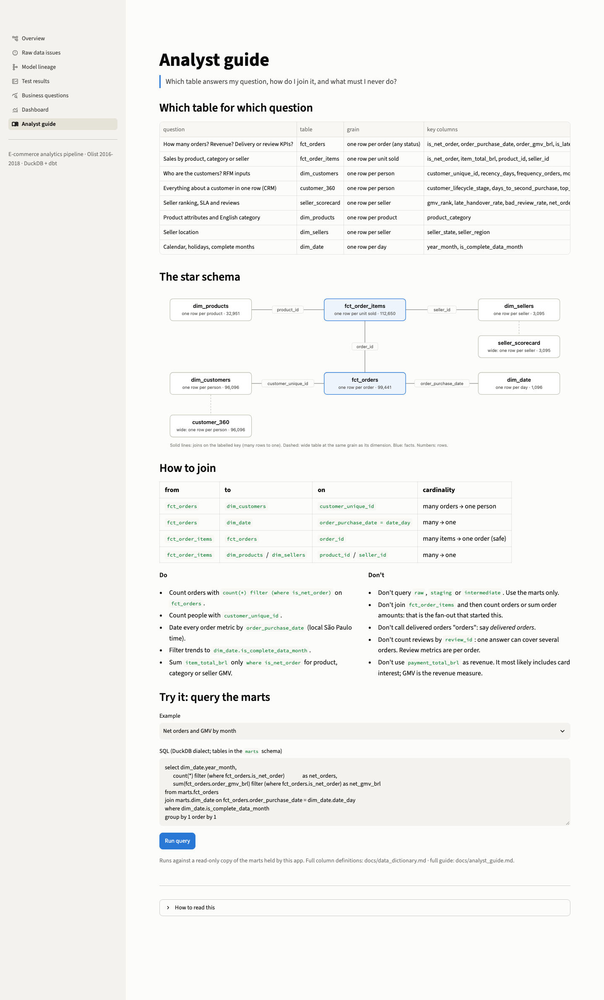 | |

## Method and data

- **Data.** Olist Brazilian e-commerce public dataset (Kaggle): 9 tables. Orders run 2016-09-04 to 2018-10-17;
  only 2017-01 to 2018-08 is complete. Prices are in BRL. Timestamps are assumed to be local São Paulo time
  ([docs/assumptions.md](docs/assumptions.md)).
- **Metrics.** Every metric has one written definition
  ([docs/02_metric_definitions.md](docs/02_metric_definitions.md)), mirrored in the semantic layer. Every headline
  number above traces to a SQL file in [`sql/`](sql/) or [`analyses/`](analyses/), and to the notebooks in
  [`notebooks/`](notebooks/) (exported to [`reports/`](reports/)).
- **Statistics.** Rates carry Wilson 95% intervals. Repeat-purchase cohorts are compared only once fully
  observed. State-level bad-review rates are compared with what lateness alone predicts.

## Limitations

- **Historical, static data.** 2016-2018 from one marketplace. Recency is measured against the last
  net-order purchase date in the data (2018-09-03).
- **Associations, not causes.** The business findings need an experiment or a holdout before anyone acts at scale.
- **No refunds.** The source has no refund table, so revenue means gross merchandise value.
- **Net orders include 1,729 open orders.** Some old "shipped" orders will probably never be delivered (ADR 0002).
- **CI uses synthetic data.** Raw data cannot be committed, so full-volume validation runs locally (`make all`).

## Repository map

```
ingestion/        Python EL: CSV -> DuckDB raw, load audit, as-of extract simulation
dbt/              dbt project: models (staging/intermediate/marts/semantic), tests, macros, seeds, snapshots
sql/              standalone SQL: data-quality checks on raw, metric reconciliations, the DQ issue register
analyses/         business questions answered from the marts (SQL + conclusions)
notebooks/        01 raw profiling · 02 order-count reconciliation · 03 business questions
dashboard/        Streamlit app (app.py + app_pages/)
src/olist_analytics/  shared code: config, cache export, analysis, charts, report builder
reports/          report.html + notebook exports
docs/             request & scope, plan, metric definitions, data dictionary, DQ checks & report,
                  assumptions, analyst guide, readout, ADRs
ci/               synthetic fixture generator and CI checks
scripts/          incremental check, SQL runner, notebook runner, screenshots, doc rendering
```

**Docs index:**
- [request and scope](docs/01_request_and_scope.md)
- [plan](docs/00_plan.md)
- [metric definitions](docs/02_metric_definitions.md)
- [data dictionary](docs/data_dictionary.md)
- [data quality checks](docs/03_data_quality_checks.md)
- [data quality report](docs/data_quality_report.md)
- [assumptions](docs/assumptions.md)
- [analyst guide](docs/analyst_guide.md)
- [readout](docs/readout.md)
- [ADRs](docs/adr/)
